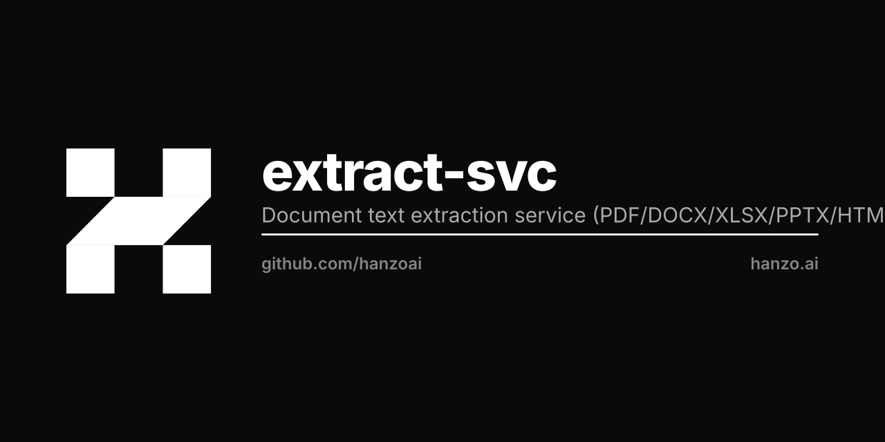

<p align="center"></p>

# extract

Document text extraction service. Drop-in replacement for Huly's `rekoni`:
takes a file (or URL), returns the plain text plus light metadata. Pure
Go, distroless, IAM-authenticated, no Python sidecars.

Image: `ghcr.io/hanzoai/extract`
Port: `4004`

## Supported formats

Format detection is by magic bytes, not filename. Filenames are advisory only.

| Format | Backend |
| --- | --- |
| PDF | `github.com/ledongthuc/pdf` (MIT, pure Go) |
| DOCX | native ZIP + XML walk (`word/document.xml`) |
| XLSX | native ZIP + XML walk (sharedStrings + sheets) |
| PPTX | native ZIP + XML walk (`ppt/slides/slide*.xml`) |
| HTML | `golang.org/x/net/html`, scripts/styles dropped |
| RTF | small native parser, ignores font/style/info groups |
| Markdown | pass-through |
| Plain text | pass-through |
| Images | rejected with HTTP 415 in v0.1 |

## API

All routes are under `/v1/`. Auth is required on extraction endpoints: bearer
JWT issued by Hanzo IAM, verified against the IAM JWKS (`IAM_JWKS_URL`,
default `https://hanzo.id/v1/iam/.well-known/jwks`). RS256 and RS512 are accepted;
HS* and `none` are rejected.

### `GET /v1/health`

```json
{ "status": "ok", "version": "v0.1.0" }
```

### `POST /v1/extract`

Multipart upload, single field `file`. Max upload 25 MB (streamed —
the service does not buffer the whole form in memory).

```bash
curl -sf \
  -H "Authorization: Bearer $HANZO_TOKEN" \
  -F "file=@resume.pdf" \
  https://api.hanzo.ai/v1/extract
```

Response:
```json
{
  "text": "Hanzo extract pdf fixture.\n",
  "metadata": { "pages": 1 },
  "format": "pdf",
  "language": "en"
}
```

### `POST /v1/extract/url`

```bash
curl -sf \
  -H "Authorization: Bearer $HANZO_TOKEN" \
  -H "Content-Type: application/json" \
  -d '{"url":"https://example.com/cv.docx"}' \
  https://api.hanzo.ai/v1/extract/url
```

Only `http://` and `https://` schemes are accepted. The remote fetch is bounded
by `FetchTimeout` (20s) and the same 25 MB cap.

## Errors

| Code | Meaning |
| --- | --- |
| 400 | malformed request (multipart, JSON, missing `file`) |
| 401 | missing / expired / unverifiable bearer |
| 403 | URL-fetch allowlist refused the target |
| 413 | upload (or remote payload) over 25 MB |
| 415 | format unsupported (e.g. images in v0.1) |
| 422 | extractor saw a recognized format but failed to parse |
| 502 | remote URL fetch failed |

All error responses are `{"error":"..."}` JSON.

## Configuration

| Env | Default |
| --- | --- |
| `LISTEN_ADDR` | `:4004` |
| `IAM_JWKS_URL` | `https://hanzo.id/v1/iam/.well-known/jwks` |

## Build & run

```bash
make test     # go test ./... with -race -cover
make build    # static linux/amd64 binary
make run      # local dev on :4004
make docker   # ghcr.io/hanzoai/extract:dev
```

## Deploy

CI builds amd64 image on tag push via shared `hanzoai/.github` workflow.
arm64 paused per global LLM.md (DOKS has no arm64 droplets as of 2026-04-27).

Kubernetes drop-in:

```yaml
containers:
- name: extract
  image: ghcr.io/hanzoai/extract:v0.1.0
  ports: [{containerPort: 4004}]
  env:
    - name: IAM_JWKS_URL
      value: https://hanzo.id/v1/iam/.well-known/jwks
  readinessProbe:
    httpGet: { path: /v1/health, port: 4004 }
  resources:
    requests: { cpu: 100m, memory: 128Mi }
    limits:   { cpu: 1,    memory: 512Mi }
```

## Notes

- No filename trust. Always magic-byte detection.
- No CGo, no shelled binaries. Distroless static base.
- Tests build OOXML and PDF fixtures at runtime — see `pkg/extract/fixtures_test.go`.
- Image OCR will land in a later version; v0.1 returns HTTP 415 with a clear message.

Licensed under **MIT OR Apache-2.0**, per [HIP-0137](https://github.com/hanzoai/hips/blob/main/HIPs/hip-0137-one-license.md).
